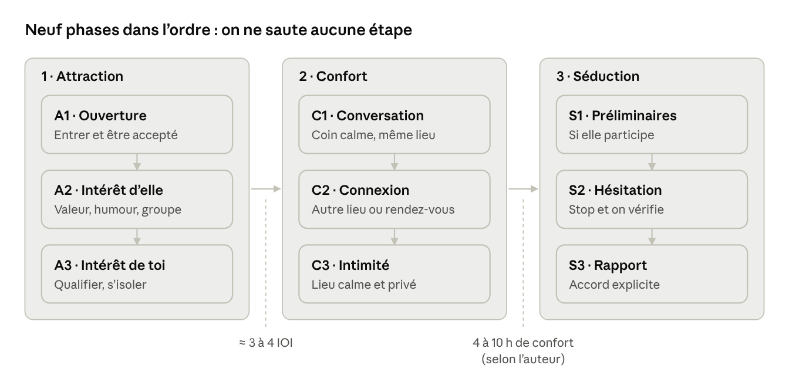

# Méthode Mystery — Fiche technique

26 octobre 2026 · LIPARIT Zakaryan · Version 2 : phrases prêtes, déroulé minute par minute, plan d'entraînement

> Version modifiable en ligne : https://claude.ai/artifact/BeCiz5zEQRDxJ5gBgkSgp9

## Sommaire

1. [Vue d'ensemble](#vue-densemble)
2. [Comment utiliser cette fiche](#comment-utiliser-cette-fiche)
3. [Le déroulé type d'une soirée, minute par minute](#le-déroulé-type-dune-soirée-minute-par-minute)
4. [Préparation avant le terrain](#préparation-avant-le-terrain)
5. [Phase A1 — Ouverture](#phase-a1--ouverture)
6. [Phase A2 — Susciter son intérêt](#phase-a2--susciter-son-intérêt)
7. [Phase A3 — Montrer ton intérêt](#phase-a3--montrer-ton-intérêt)
8. [Phases C1 à C3 — Confort](#phases-c1-à-c3--confort)
9. [Phases S1 à S3 — Séduction](#phases-s1-à-s3--séduction)
10. [Carte de poche](#carte-de-poche)
11. [Plan d'entraînement sur 4 semaines](#plan-dentraînement-sur-4-semaines)
12. [Checklist terrain](#checklist-terrain)
13. [Erreurs fréquentes et limites](#erreurs-fréquentes-et-limites)
14. [Sources](#sources)

## Vue d'ensemble

La méthode Mystery découpe la séduction en 3 étapes et 9 phases à franchir dans l'ordre : Attraction (A1 à A3), Confort (C1 à C3), Séduction (S1 à S3). Elle a été conçue par Erik von Markovik, dit « Mystery », ancien magicien canadien, et rendue célèbre par le livre *The Game* de Neil Strauss. L'auteur appelle ce découpage le « modèle M3 » ([résumé détaillé](https://aseemgupta.com/the-mystery-method-by-mystery)).

**Les 6 principes à retenir avant tout**

- **Ordre strict** : on ne saute aucune phase. L'attraction vient avant le confort, le confort avant la séduction.
- **L'attraction ne suffit pas** : c'est le confort (confiance, connexion) qui donne envie de te revoir.
- **On avance au signal, pas à l'instinct** : chaque passage se décide en lisant ses indicateurs d'intérêt (IOI) ou de désintérêt (IOD).
- **Repère de durée** : selon l'auteur, il faut 4 à 10 heures de confort cumulé, 7 heures en moyenne, non forcément d'affilée. Ce chiffre n'a aucune base scientifique, c'est un ordre de grandeur.
- **Trois types de lieux** : le lieu de rencontre, les lieux de confort, le lieu d'intimité.
- **Trois façons de bouger** : se déplacer dans le même lieu, changer de lieu le soir même (« bounce »), ou fixer un rendez-vous plus tard (« time bridge ») ([notes de lecture](https://marloyonocruz.com/2018/10/26/book-notes-the-mystery-method-by-mystery)).



On lit les étapes de gauche à droite et les phases de haut en bas ; on ne passe à l'étape suivante qu'au signal indiqué sous la flèche.

## Comment utiliser cette fiche

- **Lis-la une fois en entier.** Ensuite, avant chaque sortie, relis seulement le [déroulé type](#le-déroulé-type-dune-soirée-minute-par-minute) et la [carte de poche](#carte-de-poche) : 5 minutes suffisent.
- **Chaque phase a trois blocs** : *Ce que tu fais* (les étapes), *Phrases prêtes* (à dire telles quelles), *Si… alors…* (quoi faire quand ça ne se passe pas comme prévu).
- **Les phrases prêtes sont des roues de vélo.** Les 3 ou 4 premières sorties, dis-les mot pour mot pour ne pas réfléchir. Ensuite, remplace-les par tes propres mots : une phrase qui te ressemble marche toujours mieux qu'une phrase apprise.
- **Les crochets [comme ça] sont à remplacer** par ton prénom, ton histoire, le lieu, etc.
- **Ton seul objectif au début : le nombre d'ouvertures**, pas le résultat. 5 ouvertures dans la soirée, c'est une soirée réussie, même si toutes ratent.

## Le déroulé type d'une soirée, minute par minute

Exemple pour un bar ou une soirée qui commence à 21 h. Les durées sont des repères de cette fiche, pas des règles du livre.

| Heure | Phase | Ce que tu fais | Ce que tu dis (exemple) | Tu passes à la suite quand… |
| --- | --- | --- | --- | --- |
| 21:00 | Arrivée | Tu commandes au bar, tu repères le coin calme et la sortie. | « Salut ! C'est quoi le cocktail que tu préfères préparer ici ? » | Tu as ton verre. |
| 21:05 | Échauffement | 3 conversations sans enjeu : le barman, un groupe d'hommes, un groupe mixte. | « Vous êtes du coin ? C'est la première fois que je viens, ça vaut quoi ici d'habitude ? » | 3 conversations faites, tu te sens chaud. |
| 21:20 | A1 Ouverture | Tu repères un groupe, tu y vas en moins de 3 secondes, corps tourné vers la sortie. | « Deux secondes, je rejoins des amis, mais j'ai besoin d'un avis rapide… » | Le groupe te pose des questions ou rit. |
| +5 min | A1 Accroche | Tu fais mine de partir. | « Bon, je vais y aller, mes amis vont croire que je les ai abandonnés. » | Le groupe te retient. |
| +5 à 15 min | A2 Intérêt d'elle | Une histoire, une taquinerie légère, tu fais rire les amis. | « Ça me rappelle un truc qui m'est arrivé… » | Tu as compté 3 IOI. |
| +15 à 25 min | A3 Intérêt de toi | Questions sur elle, contact léger, isolement. | « Viens, on va s'asseoir là-bas, on s'entendra mieux. » | Elle te suit dans le coin calme. |
| +25 à 60 min | C1 Conversation | Points communs, écoute, une vulnérabilité. | « Tu as dit [Lisbonne] tout à l'heure, tu y retournerais pour y vivre ? » | La conversation est fluide et personnelle. |
| Fin | Time bridge ou bounce | Échange de numéro avec une idée précise, ou changement de lieu. | « On continue ça jeudi autour d'un verre ? Donne-moi ton numéro. » | Elle te donne son numéro ou te suit. |

**Si ça rate à n'importe quelle étape** : « Merci, bonne soirée ! », sourire, et tu ouvres le groupe suivant dans les 2 minutes. Ne reste jamais seul plus de 2 minutes à ressasser.

## Préparation avant le terrain

La moitié du résultat se joue avant de sortir : état d'esprit, présentation, matériel de conversation et échauffement.

1. **État d'esprit**
   - Règle de base de l'auteur : « quoi qu'il arrive, ce n'est pas grave ». Un refus n'est pas un échec, c'est une répétition.
   - Arrive déjà en mode social : sourire, enthousiasme, énergie. Les gens suivent l'humeur de celui qui mène.
   - Considère que l'endroit le plus agréable de la soirée, c'est là où tu es. Tu ne cours pas après le groupe d'à côté.
2. **Présentation (le « peacocking »)**
   - Porte un détail vestimentaire qui attire l'œil et lance la conversation : une bague, une montre, une veste, un accessoire.
   - Il doit coller à ta personnalité. Un détail que tu portes mal donne l'effet inverse.
   - Exemple concret : une bague originale rapportée d'un voyage. Quand on te pose la question, tu as déjà une histoire prête (« Je l'ai achetée à [ville] à un vieux monsieur qui… »).
3. **Matériel à préparer**
   - 1 phrase d'ouverture mémorisée (voir [A1](#phase-a1--ouverture)).
   - 1 phrase de contrainte de temps, du type « je n'ai qu'une minute, je rejoins des amis ».
   - 3 histoires courtes qui montrent tes qualités (modèle juste en dessous).
   - Chaque phrase ou histoire demande environ 20 à 25 essais avant de sortir naturellement. Entraîne-toi à voix haute.
4. **Lieu et logistique**
   - Choisis des lieux sociaux : bars, soirées, cafés, événements, salons.
   - Repère d'avance un coin plus calme dans le lieu (pour C1) et un deuxième lieu proche, à moins de 5 minutes à pied (pour un éventuel changement de lieu).
5. **Échauffement (15 à 20 minutes)**
   - En arrivant, lance 3 à 5 conversations sans enjeu : le barman, un groupe d'hommes, un groupe mixte.
   - Ne reste jamais immobile à observer la salle. Celui qu'on remarque, c'est celui qui participe.
6. **Ailier (optionnel)**
   - Celui qui ouvre le groupe mène l'interaction et choisit en premier.
   - Le rôle de l'ailier : occuper les amis pour laisser du temps en tête-à-tête, jamais « voler » la personne visée.
   - Phrase de l'ailier pour occuper les amis : « Et vous, vous êtes plutôt soirée qui finit à minuit ou à 5 heures du matin ? »

### Tes 3 histoires : le modèle à remplir

Prépare **une histoire de chaque type**. Durée cible : 60 à 90 secondes, chronomètre en main.

| Type | Ce qu'elle montre | Idée de départ |
| --- | --- | --- |
| Histoire drôle | Humour, autodérision, aisance | Un truc absurde qui t'est arrivé en voyage, au travail, avec un ami |
| Histoire de passion | Que tu as une vie riche et des projets | Ce que tu fais en dehors du travail et pourquoi ça t'anime |
| Histoire de cœur | Que tu prends soin des autres | Un moment où tu as aidé un ami, ta famille, ton équipe |

**La structure en 5 temps** (à suivre pour chaque histoire) :

1. **Accroche** (1 phrase) : « Il m'est arrivé un truc complètement absurde à [ville]… »
2. **Contexte** (2 phrases) : où, quand, avec qui.
3. **Problème** (2-3 phrases) : ce qui a mal tourné ou surpris.
4. **Chute** (1-2 phrases) : la fin drôle, touchante ou inattendue.
5. **Relance** (1 question au groupe) : « Ça vous est déjà arrivé, vous ? »

**Exemple rempli (histoire drôle, à adapter à ta vraie vie)** :

> « Il m'est arrivé un truc absurde à Rome l'été dernier. *(accroche)* J'étais avec un ami, on arrive à minuit, et notre appartement de location… n'existait pas. *(contexte)* Le propriétaire ne répond plus, on traîne nos valises dans les rues, et un vieux monsieur nous voit galérer devant son restaurant. *(problème)* Résultat : il nous a fait dormir dans la salle du resto, et à 7 heures du matin sa femme nous a réveillés avec des cafés en nous engueulant parce qu'on était trop maigres. *(chute)* Vous avez déjà eu une galère de voyage qui finit mieux que prévu ? » *(relance)*

**Exemple rempli (histoire de passion)** :

> « Je me suis mis à [la boxe / la cuisine / la photo] il y a deux ans, un peu par défi. Au début j'étais nul, vraiment le plus mauvais du cours. Mais j'ai continué, trois fois par semaine, et le mois dernier [j'ai fait mon premier combat amateur / j'ai cuisiné pour 20 personnes / un magazine a publié une de mes photos]. Ce qui me plaît, c'est de partir de zéro et de voir le progrès. Et toi, c'est quoi le truc que tu as commencé et que tu n'as jamais lâché ? »

Règle : **une histoire vraie, simplement mieux racontée**. Une histoire inventée se voit tôt ou tard, et elle ne tiendra pas au deuxième rendez-vous.

### Ta préparation sur 7 jours avant la première sortie

| Jour | Exercice | Durée |
| --- | --- | --- |
| J1 | Écris tes 3 histoires avec la structure en 5 temps. Choisis ta phrase d'ouverture et ta phrase de contrainte de temps. | 30 min |
| J2 | Dis chaque histoire 10 fois à voix haute, chrono en main. Coupe tout ce qui dépasse 90 secondes. | 20 min |
| J3 | Enregistre-toi sur ton téléphone. Réécoute : enlève les « euh », ralentis le débit. | 20 min |
| J4 | Ouverture + contrainte de temps + « bon, je vais y aller » : 20 fois devant le miroir. | 15 min |
| J5 | 10 micro-conversations dans la journée : boulanger, caissier, un passant à qui tu demandes un conseil. | Dans la journée |
| J6 | Raconte une de tes histoires à un ami ou un collègue, sans prévenir que c'est un exercice. | 5 min |
| J7 | Première sortie : objectif 5 ouvertures, rien d'autre. | 2 h |

## Phase A1 — Ouverture

Objectif : entrer dans un groupe et y être accepté, sans montrer tout de suite un intérêt romantique.

### Ce que tu fais

1. **Repère un groupe et lance-toi en moins de 3 secondes.** C'est la « règle des 3 secondes » : au-delà, l'anxiété prend le dessus et tu te trouves des excuses. Astuce : compte « 1, 2, 3 » dans ta tête et marche à « 3 », pas après.
2. **Ouvre de façon indirecte.** Demande un avis, fais une observation sur la situation, ou raconte une courte anecdote. Pas de compliment direct au départ : il met la pression et déclenche les défenses.
3. **Ajoute une contrainte de temps dès les premiers mots.** Le groupe sait que tu ne vas pas t'incruster, il se détend.
4. **Garde une posture « sur le départ ».** Corps légèrement tourné vers la sortie, tête vers le groupe. L'auteur appelle ça le « body rocking » : c'est une contrainte de temps sans paroles.
5. **Parle au groupe entier, pas d'abord à la personne qui t'intéresse.** Gagne les amis, et surtout les hommes du groupe : ils deviennent tes alliés au lieu d'obstacles. Repère pratique : pendant les 5 premières minutes, adresse-lui moins de la moitié de tes phrases.
6. **Repère le point d'accroche.** Le groupe te pose des questions, rit, se tourne vers toi : il veut que tu restes. À ce moment, relance une contrainte de temps : c'est le groupe qui te retient.
7. **Adapte-toi à la situation.**
   - Groupe assis : ouvre debout, puis assieds-toi en continuant de parler, sans pause.
   - Groupe qui marche : marche légèrement devant, lance ta phrase en tournant la tête, puis ralentis. Ils se calent sur ton rythme.

### Phrases prêtes

Choisis **une seule** ouverture et répète-la jusqu'à ce qu'elle sorte toute seule. Prends une question qui t'intéresse vraiment : tu seras plus naturel.

**Ouvertures « avis »** (bar, soirée)

- « Deux secondes, je rejoins des amis, mais j'ai besoin d'un avis rapide : c'est quoi le pire cadeau qu'on puisse faire à un premier anniversaire de couple ? »
- « Petite question avant que je file : vous êtes plutôt du genre à répondre aux messages tout de suite, ou à attendre exprès ? »
- « J'ai besoin d'un jury neutre deux minutes : est-ce qu'on peut encore porter des baskets blanches à un mariage ? »

**Ouvertures « observation »** (sur ce qui se passe autour)

- « Vous avez l'air d'être la seule table qui s'amuse vraiment ici. C'est quoi l'occasion ? »
- « Attendez, vous fêtez quelque chose ? Vous avez l'énergie d'un anniversaire. »

**Ouvertures de jour** (café, librairie, marché, salon)

- Café : « Excuse-moi, tu as l'air d'une habituée : c'est quoi le meilleur truc à prendre ici ? »
- Librairie : « Tu l'as lu, celui-là ? J'hésite et la couverture ne m'aide pas. »
- Salon ou événement : « Vous êtes là pour quelle conférence ? J'essaie de savoir si la suivante vaut le coup. »

**Alternative directe** (si l'indirect ne te ressemble pas) : « Salut, je passais et je me suis dit que je regretterais de ne pas venir te dire bonjour. Je m'appelle [prénom]. » Moins Mystery, plus honnête, et très efficace si tu le dis calmement en souriant.

**Contraintes de temps** (choisis-en une)

- « Je n'ai qu'une minute, mes amis m'attendent au bar. »
- « Deux secondes, je dois retourner voir mes potes. »
- « Juste une question rapide et je vous laisse tranquilles. »

**Relances pour faire vivre la conversation** (quand le groupe a répondu)

- Vers une autre personne du groupe : « Et toi, tu en penses quoi ? Tu as l'air de ne pas être d'accord. »
- « Attendez, comment vous vous connaissez, tous ? »
- « Ok, et la vraie question : qui est le plus en retard de la bande ? »

**Faire mine de partir** (pour vérifier l'accroche)

- « Bon, je vais y aller, mes amis vont croire que je les ai abandonnés. »

### Si… alors…

| Situation | Tu fais / tu dis |
| --- | --- |
| Réponses d'un mot, regards ailleurs | « Merci pour l'avis, bonne soirée ! » Sourire, tu pars. Groupe suivant dans les 2 minutes. |
| Un homme du groupe se montre méfiant | Tu t'adresses à lui en premier : « Et toi, ton avis ? » Tu le fais rire avant elle. |
| Blanc, tu ne sais plus quoi dire | Tu lances ton histoire n° 1, ou : « Bon, comment vous vous êtes rencontrés, vous tous ? » |
| On te dit « on est entre nous ce soir » | « Pas de souci, bonne soirée ! » Tu pars sans discuter. |
| Elle dit qu'elle a un copain, ou un homme se présente comme tel | Tu souris : « Ah, bien joué à lui. » Une minute de discussion avec le groupe, puis tu pars. Aucun jeu. |
| Le groupe te retient quand tu fais mine de partir | Tu restes : tu passes en A2. |

**Règles d'or de l'ouverture**

- N'offre pas de verre pour entrer dans un groupe.
- Accepte de te planter : un groupe froid, c'est normal, tu remercies et tu passes au suivant.
- Repère de l'auteur : si tu n'as reçu aucun indicateur d'intérêt au bout d'environ 25 minutes, la première impression est ratée. Pars poliment.

## Phase A2 — Susciter son intérêt

Objectif : faire naître de l'intérêt pour toi, puis le mesurer. On passe à A3 après environ 3 à 4 indicateurs d'intérêt.

### Ce que tu fais

1. **Montre ta valeur sans te vanter.** L'auteur parle de « DHV » (démonstration de valeur élevée). Concrètement :
   - une histoire qui montre une passion, une aventure, une compétence ;
   - de l'humour et de l'aisance ;
   - le fait que le groupe t'apprécie (les autres valident pour toi) ;
   - du leadership : c'est toi qui proposes, qui animes.
2. **Gagne tout le groupe.** C'est la « théorie du groupe » : une personne entourée d'amis qui t'apprécient te regarde déjà autrement. Occupe-toi des amis autant que d'elle.
3. **Taquine au lieu de complimenter.** Le livre utilise le « neg » : une petite remarque qui montre que tu n'es pas impressionné d'office. C'est la technique la plus critiquée de la méthode. Dans une étude de 2017 sur 308 personnes, le « negging » est jugé nettement plus blessant que des phrases d'approche classiques ([étude](https://www.sciencedirect.com/org/science/article/abs/pii/S1759659917000282)). **Version de cette fiche** : une taquinerie bienveillante, sur un détail neutre (une manie, une opinion, un choix de boisson), jamais sur son physique ou une insécurité. Si elle ne rit pas, tu laisses tomber.
4. **Alterne valeur et taquinerie, et évite les signaux de faible valeur.** À éviter : chercher son approbation, se vanter frontalement, payer pour obtenir de l'attention, rester collé à elle.
5. **Compte les indicateurs d'intérêt (IOI).**

### Phrases prêtes

**Pour lancer une histoire sans que ça fasse « numéro »**

- « Ça me rappelle un truc qui m'est arrivé… »
- « Attends, vous allez rire, la semaine dernière… »
- « C'est drôle que tu dises ça, parce que… »

**Taquineries bienveillantes** (toujours sur un choix ou une attitude, jamais sur le physique)

| Ce qu'elle fait | Ce que tu dis |
| --- | --- |
| Elle commande un cocktail d'été en hiver | « Un mojito en novembre ? Toi, tu vis en été permanent. » |
| Elle organise visiblement le groupe | « Je devine : c'est toi qui as choisi le bar, et c'est toi qui décideras quand on part. » |
| Elle finit tes phrases | « Tu finis toujours les phrases des gens ? Je sens qu'on va se battre pour le dernier mot. » |
| Elle avoue un goût banal ou ringard | « Attends, tu viens d'avouer ça en public ? Respect pour le courage. » |
| Elle te contredit | « Ok, toi tu es clairement l'avocate du diable de la bande. » |

Après chaque taquinerie : un sourire, puis **une vraie question** (« Non, sérieusement, pourquoi tu aimes ça ? »). Si elle ne rit pas : « Je te taquine », et tu passes à autre chose.

**Pour gagner les amis**

- « Vous vous connaissez depuis combien de temps ? »
- « Qui est le plus drôle de la bande ? Et qui est le plus en retard ? »
- À l'homme du groupe : « Toi, tu as une tête à avoir des bonnes histoires de voyage. »

**Pour montrer du leadership**

- « Venez, on fait un jeu : chacun dit le pire job qu'il a eu. Je commence. »
- « Il fait trop chaud ici, on se met près de la fenêtre ? »

### Compte tes IOI : méthode concrète

Compte discrètement sur tes doigts, un doigt par IOI. **À 3 doigts, tu passes en A3.**

| Indicateurs d'intérêt (IOI) | Indicateurs de désintérêt (IOD) |
| --- | --- |
| Elle te demande ton prénom, ton âge, ce que tu fais | Réponses courtes, aucune question en retour |
| Elle te demande si tu es célibataire | Elle regarde ailleurs ou son téléphone |
| Elle rit à tes blagues, même moyennes | Elle se tourne vers ses amis et te ferme le dos |
| Elle te touche le bras, se rapproche | Elle recule quand tu t'approches |
| Elle relance la conversation quand tu fais mine de partir | Elle cherche un prétexte pour s'éloigner |
| Elle revient vers toi après s'être éloignée | Elle t'ignore quand tu reviens |

### Si… alors…

| Situation | Tu fais / tu dis |
| --- | --- |
| Elle rit mais ne pose aucune question | Tu continues avec le groupe, tu attends. 1 IOI ne suffit pas. |
| 2 ou 3 IOD de suite | Tu reviens vers les amis 5 minutes. Toujours froid ? « Ravi de vous avoir rencontrés ! » et tu pars. |
| Une amie veut l'emmener ailleurs | « Allez-y, on se recroise tout à l'heure. » Tu ne retiens personne. |
| Tu as 3 IOI clairs | Tu passes en A3. |

**Passage à A3** : environ 3 à 4 IOI clairs. Face à des IOD répétés, retourne au groupe ou pars poliment.

## Phase A3 — Montrer ton intérêt

Objectif : lui montrer que tu t'intéresses à elle pour ce qu'elle est, pas seulement pour son physique, puis passer en tête-à-tête.

### Ce que tu fais

1. **Qualifie-la.** Pose des questions sur ce qui la rend unique : ses passions, ses projets, ce qui la fait vibrer. Tu montres que tu as des critères et que tu ne t'intéresses pas à tout le monde.
2. **Récompense ses efforts.** Quand elle se dévoile ou fait un effort pour te plaire, montre ton intérêt en retour : un sourire, un compliment sincère et précis, une attention. C'est l'équilibre « je m'approche, je recule » que l'auteur compare au chat et à la pelote de laine.
3. **Introduis un contact léger et progressif.** Une main sur l'avant-bras en riant, un « tope là ». La règle de l'auteur : un pas en avant, et au moindre signe d'hésitation, deux pas en arrière. Si elle se raidit ou recule, tu arrêtes.
4. **Isole-toi avec elle, dans le même lieu.** Propose d'aller dans un coin plus calme. Préviens ses amies pour qu'elles ne s'inquiètent pas.

### Phrases prêtes

**Questions de qualification** (choisis-en 2, pas plus : ce n'est pas un interrogatoire)

- « À part ça, qu'est-ce qui te fait vraiment vibrer en ce moment ? »
- « C'est quoi le truc que tu fais et que tes amis trouvent bizarre ? »
- « Si tu avais un an sans aucune contrainte, tu ferais quoi ? »
- « Qu'est-ce que tu veux absolument faire avant la fin de l'année ? »

**Récompenser quand elle se livre** (un compliment précis, sur ce qu'elle dit ou fait, pas sur son physique)

- « Ça, j'aime bien. Peu de gens osent vraiment se lancer. »
- « Tu en parles avec une énergie… on voit que ça compte pour toi. »
- « Ok, tu viens de remonter dans mon estime. »

**Contact léger** (moments naturels)

- Elle dit un truc drôle : tu lèves la main pour un « tope là ».
- Tu ris : main sur son avant-bras, 1 seconde, puis tu retires.
- Vous traversez la foule : « Suis-moi », en lui tendant la main.

**Isolement**

- À elle : « Viens, on va s'asseoir là-bas, on s'entendra mieux. »
- À ses amies : « Je vous l'emprunte cinq minutes, je vous la rends, promis. »

### Si… alors…

| Situation | Tu fais / tu dis |
| --- | --- |
| Elle se raidit au contact | Tu retires ta main naturellement et tu continues à parler. Pas de nouveau contact avant d'autres IOI. |
| Elle refuse de s'isoler | « Ok, pas de souci. » Tu restes 10 minutes avec le groupe, tu peux reproposer une seule fois. |
| Elle refuse une deuxième fois | Tu proposes un time bridge : « On continue cette discussion autour d'un café cette semaine ? » |
| Elle accepte | Tu passes en C1. |

**Passage à C1** : elle accepte de s'isoler avec toi et la conversation devient personnelle. Si elle préfère rester avec ses amies, reste dans le groupe et réessaie plus tard.

## Phases C1 à C3 — Confort

Objectif : construire la confiance et une vraie connexion. Pour l'auteur, c'est ici que tout se joue, et ça prend du temps (4 à 10 heures cumulées selon lui).

### C1 — Conversation (même lieu, coin calme)

**Ce que tu fais**

1. **Sois bavard.** Raconte, relance, rebondis. Le silence gênant tue le confort.
2. **Cherche les points communs** : lieux, goûts, valeurs, expériences. Chaque point commun rapproche.
3. **Écoute vraiment.** Reformule ce qu'elle dit, pose des questions de suivi.
4. **Partage une vulnérabilité maîtrisée** : une anecdote sincère qui te rend humain, racontée sans te plaindre.
5. **Termine toujours sur du C1, jamais sur de l'attraction seule.** Échange vos contacts en proposant une idée concrète pour vous revoir (« time bridge »). Sans confort, tu n'es qu'un type sympa croisé en soirée.

**Phrases prêtes : les questions en 3 niveaux** (on descend un niveau toutes les 10 à 15 minutes)

| Niveau | Questions |
| --- | --- |
| Léger | « Tu as grandi où ? » · « C'est quoi ton quartier préféré ? » · « Ton meilleur souvenir de vacances ? » |
| Moyen | « Qu'est-ce qui t'a fait choisir ton métier ? » · « C'est quoi le voyage qui t'a le plus changée ? » · « Tu es plutôt lève-tôt ou couche-tard ? » |
| Profond | « C'est quoi le truc dont tu es la plus fière ? » · « Qu'est-ce que tu as changé dans ta vie ces dernières années ? » · « Qu'est-ce qui compte le plus pour toi chez les gens ? » |

**La technique du fil** (pour ne jamais être à court) : reprends **un mot** de sa réponse et pose une question dessus.

> Elle : « J'ai vécu un an à Lisbonne pour mes études. »
> Toi : « Lisbonne… tu y retournerais pour y vivre ? »
> Elle : « Peut-être, la mer me manque. »
> Toi : « La mer ou le soleil ? Parce que ce n'est pas la même personnalité. »

**Vulnérabilité maîtrisée** (exemple à adapter)

> « Honnêtement, il y a quelques années j'étais incapable de parler devant plus de trois personnes. Je me suis forcé à présenter en réunion chaque semaine, et aujourd'hui j'adore ça. Comme quoi. »

**Échange de numéro (time bridge)**

- « J'ai passé un vrai bon moment. Tu m'as parlé de [l'expo / ce resto] : on y va ensemble jeudi ou samedi ? Donne-moi ton numéro. »
- Tu lui envoies un message **tout de suite, devant elle** : « C'est [prénom], le type de [la blague commune] ». Comme ça, elle a ton nom et tu sais que le numéro est le bon.

**Changement de lieu le soir même (bounce)**

- « J'ai un petit creux. Il y a un endroit à 5 minutes qui fait les meilleures [frites / crêpes] du quartier. On y va ? Tes amies peuvent venir aussi. »

**Messages après la rencontre**

| Quand | Message type |
| --- | --- |
| Dans les 24 h | « Salut [prénom] ! J'espère que [la fin de soirée / le débat sur les baskets] s'est bien terminé 😄 » |
| Après sa réponse | « Je t'avais parlé de [lieu]. Jeudi 19 h, ça te dit ? » (toujours jour + heure + lieu précis) |
| Pas de réponse après 3-4 jours | Une seule relance, légère : « Je retente ma chance : [lieu], cette semaine ? » |
| Toujours rien | Tu laisses tomber. Pas de troisième message. |

Règle : messages courts, c'est toi qui proposes, et tu gardes les vraies conversations pour le rendez-vous.

### C2 — Connexion (autre lieu ou rendez-vous)

**Ce que tu fais**

1. **Change de lieu**, le soir même (aller boire un verre ailleurs, manger un morceau) ou lors d'un rendez-vous plus tard.
2. **Multiplie les lieux.** Trois endroits en une soirée donnent l'impression de se connaître depuis plus longtemps.
3. **Crée des expériences partagées** : une activité, une balade, un jeu, un concert. Vous construisez vos propres souvenirs et vos blagues communes.
4. **Entre les rendez-vous**, garde le lien par message ou téléphone, sans en faire trop.
5. **Le baiser.** L'auteur le range dans le confort, pas dans la séduction : un baiser ne veut pas dire qu'elle veut aller plus loin. Repère : attends au moins 3 indicateurs d'intérêt, et montre ou demande clairement ton intention plutôt que de foncer.

**Le rendez-vous « 3 lieux » clé en main**

Prépare les 3 lieux à l'avance, à moins de 10 minutes à pied les uns des autres.

| Étape | Durée | Exemple | Phrase de transition |
| --- | --- | --- | --- |
| Lieu 1 : verre ou café | 45 min | Café calme, terrasse | — |
| Lieu 2 : activité | 45 à 60 min | Balade, expo, marché, bar à jeux, disquaire | « Viens, je te montre un endroit sympa à 5 minutes. » |
| Lieu 3 : dîner ou dernier verre | 1 h | Petit resto, bar à vin | « J'ai faim, on finit au [resto] ? Je l'adore. » |

**Idées d'activités** : bar à jeux, escape game, cours de cuisine d'un soir, expo, karaoké, mini-golf, marché, concert dans un petit bar.

**Le baiser : comment faire concrètement**

1. Tu as compté au moins 3 IOI ce soir-là (elle te touche, se rapproche, te regarde longtemps).
2. Moment calme, vous êtes proches, un silence confortable s'installe.
3. Tu dis simplement, en la regardant : « J'ai très envie de t'embrasser. »
4. Tu attends sa réponse. Elle se rapproche ou sourit : tu y vas doucement. Elle hésite ou détourne la tête : « Pas de souci », un sourire, et tu reprends la conversation normalement, sans bouder.

**Si… alors…**

| Situation | Tu fais / tu dis |
| --- | --- |
| Elle annule le rendez-vous | « Pas de souci ! Dis-moi quand tu es dispo. » Tu attends qu'elle propose une date. |
| Silence gênant pendant le rendez-vous | Tu proposes de bouger : « Viens, on marche un peu. » Ou tu lances une histoire. |
| Elle refuse le lieu 2 ou 3 | « Ok, on se refait ça une prochaine fois. » Tu la raccompagnes, bonne soirée. |
| Elle accepte les 3 lieux et prolonge | Signal pour C3, ce soir ou au prochain rendez-vous. |

### C3 — Intimité (lieu calme et privé)

**Ce que tu fais**

1. **Propose une raison simple et sincère** de venir chez toi ou chez elle : un film, de la musique, un plat à goûter.
2. **Prépare le lieu** : propre, lumière douce, musique, de quoi boire.
3. **Continue la conversation en profondeur**, plus personnelle, assis côte à côte.
4. **Rappelle-toi qu'elle peut partir à tout moment** et que c'est très bien ainsi.

**Phrases prêtes** (toujours avec une porte de sortie pour elle)

- « J'ai [un vinyle / un vin / un dessert] que je voulais te faire découvrir. On passe chez moi ? Sinon on reste ici, comme tu préfères. »
- « Il commence à faire froid. On peut finir la soirée chez moi avec un thé, ou je te raccompagne, tu choisis. »

**Si elle dit non** : « Ok, avec plaisir une autre fois. » Tu continues la soirée ou tu la raccompagnes. Tu ne reproposes pas le soir même.

**Checklist du lieu (à faire avant de sortir)**

- [ ] Appartement rangé, salle de bain propre
- [ ] Lumière douce (lampe, pas le plafonnier)
- [ ] Playlist prête
- [ ] De quoi boire, avec et sans alcool
- [ ] De quoi grignoter

| Phase | Lieu | À faire | À éviter |
| --- | --- | --- | --- |
| C1 | Coin calme du lieu de rencontre | Conversation personnelle, échange de contacts | Rester en mode séduction et blagues |
| C2 | Autre bar, restaurant, activité | Expériences partagées, plusieurs lieux | Le rendez-vous « entretien d'embauche » |
| C3 | Chez toi ou chez elle | Moment calme, conversation profonde | Mettre la pression pour aller plus loin |

## Phases S1 à S3 — Séduction

Règle unique de cette phase : on n'avance que si elle participe activement, et chaque étape se fait avec son accord clair.

### S1 — Préliminaires

1. **Avance par petites étapes**, en laissant à chaque fois de la place pour qu'elle réponde.
2. **Lis sa réponse** : elle se rapproche, t'embrasse en retour, prend des initiatives. Si elle reste passive ou se fige, tu ralentis.
3. **Demande, simplement.** Ça ne casse pas l'ambiance ; ça rassure.

**Phrases prêtes**

- « Ça te va ? »
- « Tu veux qu'on continue ? »
- « Dis-moi si tu veux qu'on ralentisse, vraiment, c'est ok. »

### S2 — Hésitation (« last minute resistance » dans le livre)

Le livre présente l'hésitation avant la première fois comme normale et donne des tactiques pour la « dépasser ». C'est la partie la plus dangereuse de la méthode : une étude de 2023 montre que ces communautés présentent ainsi le refus des femmes comme un obstacle à contourner ([étude IJOC](https://ijoc.org/index.php/ijoc/article/download/20283/4284)). Cette fiche ne reprend pas ces tactiques.

**À la place, la règle est simple :**

1. **Une hésitation = tu t'arrêtes** et tu lui demandes comment elle se sent.
2. **Un non = c'est terminé pour ce soir**, sans bouder, sans insister, sans « refroidir » l'ambiance pour la faire céder.
3. **Reviens au confort** : discussion, câlin si elle le veut, proposition de se revoir.
4. Pousser quelqu'un qui hésite, c'est franchir la ligne du consentement, et ça peut relever du pénal.

**Phrases prêtes**

- Elle hésite : « On n'est pas pressés. Tu veux qu'on se pose et qu'on discute ? »
- Elle dit non : « Ok, aucun souci. » Puis : « Tu veux un thé ? Je te raccompagne quand tu veux. »
- Le lendemain, quoi qu'il se soit passé : « J'ai passé une super soirée avec toi. On se refait ça ? »

### S3 — Rapport

1. **Consentement explicite**, protection, respect du rythme de chacun.
2. **Le lendemain compte** : l'auteur lui-même rappelle qu'une relation ne s'arrête pas après la première nuit. Un message, de la considération, de l'honnêteté sur ce que tu cherches.

**Message du lendemain**

- « Merci pour hier, j'ai passé un très bon moment avec toi. [Ce que tu cherches, honnêtement : « J'ai envie de te revoir », ou « Je préfère être clair : je ne cherche rien de sérieux en ce moment ».] »

## Carte de poche

À copier dans les notes de ton téléphone et à relire 5 minutes avant d'entrer.

```
AVANT D'ENTRER
- 3 conversations d'échauffement (barman, groupe d'hommes, groupe mixte)
- Repérer : coin calme + 2e lieu à 5 min

A1 OUVERTURE (en moins de 3 s)
"Deux secondes, je rejoins des amis, mais j'ai besoin d'un avis rapide..."
Corps tourné vers la sortie. Parler à TOUT le groupe.
Accroche : "Bon, je vais y aller..." -> ils te retiennent ? On reste.

A2 INTÉRÊT D'ELLE
"Ça me rappelle un truc qui m'est arrivé..." (histoire 60-90 s)
1 taquinerie sur un choix, jamais le physique, puis 1 vraie question.
Compter les IOI sur les doigts -> 3 = on passe.

A3 INTÉRÊT DE TOI
"Qu'est-ce qui te fait vraiment vibrer en ce moment ?"
Compliment précis sur ce qu'elle DIT.
"Viens, on s'assoit là-bas, on s'entendra mieux."
Aux amies : "Je vous l'emprunte 5 minutes."

C1 CONVERSATION
Léger -> moyen -> profond. Technique du fil : reprendre 1 mot.
Fin : "On y va jeudi ou samedi ? Donne-moi ton numéro."
Message tout de suite devant elle.

TOUJOURS
Froid = "Merci, bonne soirée !" -> groupe suivant en 2 min.
Hésitation ou non = on s'arrête. Point.
Objectif du soir : 5 ouvertures.
```

## Plan d'entraînement sur 4 semaines

Un seul objectif par semaine. Tu ne passes à la semaine suivante que si l'objectif est atteint.

| Semaine | Sorties | Objectif unique | Tu as réussi si… |
| --- | --- | --- | --- |
| 1 | 3 | Ouvrir : ouverture + contrainte de temps + partir | 5 ouvertures par sortie, quel que soit le résultat |
| 2 | 3 | Tenir : rester 10 minutes et raconter une histoire | 1 histoire racontée par sortie |
| 3 | 3 | Isoler : une fois par soirée + 15 minutes de C1 | 1 isolement réussi dans la semaine |
| 4 | 3 | Conclure : échange de numéro + 1 rendez-vous « 3 lieux » | 1 rendez-vous fixé |

**Journal après chaque sortie (3 minutes, 3 questions)**

1. Qu'est-ce qui a marché ce soir ?
2. Où est-ce que je me suis bloqué, et à quelle phase ?
3. Qu'est-ce que je change à la prochaine sortie ? (une seule chose)

## Checklist terrain

Le résumé à relire avant de sortir : une ligne par phase, avec le signal qui autorise à passer à la suivante.

| Phase | Objectif | Action clé | Phrase type | Signal pour passer |
| --- | --- | --- | --- | --- |
| A1 Ouverture | Être accepté par le groupe | Ouverture indirecte en moins de 3 s + contrainte de temps | « Deux secondes, j'ai besoin d'un avis… » | Le groupe te retient |
| A2 Intérêt d'elle | Faire naître son intérêt | Histoires, humour, gagner les amis, taquinerie légère | « Ça me rappelle un truc… » | 3 à 4 IOI |
| A3 Intérêt de toi | Montrer un intérêt sincère | Questions sur elle, contact léger, isolement | « Viens, on s'assoit là-bas. » | Elle accepte de s'isoler |
| C1 Conversation | Créer la confiance | Points communs, écoute, échange de contacts | « On y va jeudi ou samedi ? » | Rendez-vous ou changement de lieu accepté |
| C2 Connexion | Approfondir | Plusieurs lieux, activités partagées | « Je te montre un endroit à 5 minutes. » | Elle propose ou accepte un moment privé |
| C3 Intimité | Se retrouver au calme | Lieu préparé, conversation profonde | « Chez moi, ou on reste ici, comme tu préfères. » | Elle prend des initiatives |
| S1 Préliminaires | Avancer ensemble | Petites étapes, demander | « Ça te va ? » | Participation active et claire |
| S2 Hésitation | Respecter | S'arrêter et vérifier | « On n'est pas pressés. » | Un oui clair, sinon on s'arrête |
| S3 Rapport | Intimité consentie | Protection, respect, suite honnête | Message du lendemain | — |

**Avant chaque sortie**

- [ ] 1 ouverture mémorisée et répétée à voix haute
- [ ] 1 phrase de contrainte de temps
- [ ] 3 histoires prêtes (drôle, passion, cœur), 60 à 90 secondes chacune
- [ ] 1 coin calme et 1 deuxième lieu repérés
- [ ] 3 à 5 conversations d'échauffement en arrivant
- [ ] Carte de poche relue

**Glossaire express**

| Terme | Sens |
| --- | --- |
| Set | Un groupe de personnes que tu abordes |
| Cible / obstacles | La personne qui t'intéresse / ses amis qui la protègent |
| IOI / IOD | Indicateur d'intérêt / de désintérêt |
| DHV | Tout ce qui montre ta valeur : humour, passions, approbation sociale |
| Contrainte de temps | Signaler que tu vas bientôt partir pour mettre à l'aise |
| Neg | Remarque taquine qui montre que tu n'es pas impressionné d'office |
| Bounce | Changer de lieu ensemble le soir même |
| Time bridge | Fixer un rendez-vous plus tard |
| Wing | Ton ailier, qui occupe les amis |

## Erreurs fréquentes et limites

La structure en 3 étapes tient la route ; plusieurs techniques et chiffres du livre, beaucoup moins.

**Les 3 pièges que l'auteur lui-même signale**

1. **Attraction non justifiée** : elle ne sait pas pourquoi tu lui plais, alors elle recule. Donne-lui des raisons (tes qualités, ce que vous partagez).
2. **Confort négligé** : passer directement de l'attraction à la séduction. Résultat : elle se ferme ou disparaît.
3. **Regret après coup** : aller trop vite crée un malaise le lendemain. Le confort protège les deux.

**Autres erreurs courantes**

- Réciter des phrases toutes faites qui sonnent faux. Une histoire n'est prête qu'après une vingtaine d'essais, et les phrases prêtes de cette fiche sont à remplacer par tes mots dès que tu es à l'aise.
- Rester bloqué en mode attraction (blagues, taquineries) sans jamais passer à une vraie conversation.
- Des taquineries trop dures, qui blessent au lieu de faire rire.
- Ignorer les signaux de désintérêt et insister.
- Enchaîner les questions comme un interrogatoire : alterne question, partage de ton côté, question.

**Limites et critiques**

- **Chiffres non prouvés** : la règle des 3 secondes ou celle des 7 heures paraissent précises, mais ne reposent sur aucune donnée solide. Les durées du déroulé type et du plan d'entraînement sont des repères pratiques de cette fiche, pas des résultats de recherche.
- **Ce qui est soutenu par la recherche** : une revue de 2012 conclut que la structure attraction, confort, séduction et des qualités comme l'humour ou l'assurance sont appuyées par la psychologie, mais que l'efficacité de chaque technique reste débattue ([Psychology Today](https://www.psychologytoday.com/us/blog/the-attraction-doctor/201301/do-pick-up-artist-techniques-really-work)).
- **Vision des femmes** : le livre note les femmes de 1 à 10 et les traite en « cibles », ce qui pousse à jouer un rôle plutôt qu'à créer une vraie relation.
- **Effets sur les hommes eux-mêmes** : une étude ethnographique de 2020 relève que l'implication dans ces communautés peut nuire au bien-être des pratiquants ([PLOS One](https://journals.plos.org/plosone/article?id=10.1371%2Fjournal.pone.0229719)).
- **Ce qu'il vaut la peine de garder** : oser aborder, s'entraîner, préparer sa conversation, lire les signaux, prendre le temps du confort. **Ce qu'il vaut mieux laisser** : les manipulations et toute pression sur un refus.

## Sources

- [The Mystery Method by Mystery — résumé et analyse critique](https://aseemgupta.com/the-mystery-method-by-mystery) (Aseem Gupta)
- [Book notes: The Mystery Method](https://marloyonocruz.com/2018/10/26/book-notes-the-mystery-method-by-mystery) (Marlo Yonocruz)
- [The Mystery Method: The 9 Steps (A1–S3)](https://thepowermoves.com/the-mystery-method/) (The Power Moves)
- [Public perceptions of « negging »](https://www.sciencedirect.com/org/science/article/abs/pii/S1759659917000282) (étude, 2017)
- [« No Does Not Always Mean No » : le refus féminin présenté comme « last minute resistance »](https://ijoc.org/index.php/ijoc/article/download/20283/4284) (International Journal of Communication, 2023)
- [Do Pick-Up Artist Techniques Really Work?](https://www.psychologytoday.com/us/blog/the-attraction-doctor/201301/do-pick-up-artist-techniques-really-work) (Psychology Today, 2013)
- [Clueless: An ethnographic study of young men in the seduction community](https://journals.plos.org/plosone/article?id=10.1371%2Fjournal.pone.0229719) (PLOS One, 2020)

Les phrases prêtes, exemples d'histoires, déroulé type et plan d'entraînement sont des propositions originales de cette fiche, pas des citations du livre.
